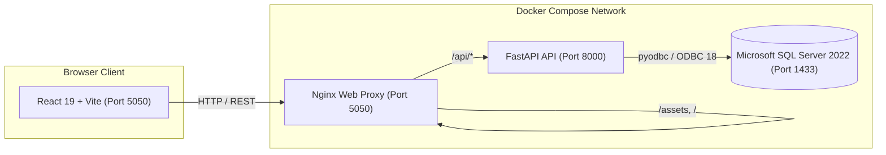

# BIA Digital Transformation Tracker

[](https://www.docker.com/)
[](https://www.python.org/)
[](https://fastapi.tiangolo.com/)
[](https://react.dev/)
[](https://www.microsoft.com/sql-server)

A private, enterprise-grade project portfolio management workspace for **BIA Textiles**. Features multiple master programmes, subproject work breakdown structures, schedule baselines, financial controls, and role-based access control (RBAC).

---

## Architecture Overview



* **Frontend**: React 19, Vite, responsive enterprise UI, Lucide icons, date-aware timeline & breakdown charts.
* **Backend API**: Python 3.12, FastAPI, SQLAlchemy 2.0 ORM, Argon2id password hashing, Uvicorn.
* **Database**: Microsoft SQL Server 2022 with normalized relational tables (`bia` schema, Schema v9).
* **Reverse Proxy**: Nginx (unprivileged Alpine) routing `/api/` traffic and serving optimized static assets.
* **Port Allocation**: Runs on **Port 5050** to avoid conflicts with other host services (e.g., Jenkins on port 8080).

---

## Key Features

### 1. Programme & Portfolio Management
* **Master Projects**: Group related initiatives under executive programmes (e.g., Factory Expansion, ERP Migration).
* **Subprojects & Milestones**: Effort-weighted completion rollups from leaf deliverables—no double counting.
* **Timeline & Dependencies**: Finish-to-start predecessor links with cycle detection and working-day calendar logic.
* **Schedule Baselines**: Immutable snapshots of agreed dates and tasks to measure project delay variance over time.

### 2. Financial Governance (USD)
* **Budgets & Commitments**: Purchase orders (POs) validated strictly against approved subproject budgets.
* **Invoice Matching**: Invoices linked to PO balances; cumulative invoices cannot exceed approved commitments.
* **Settlement Tracking**: Records invoice payment references and settlement dates without initiating external bank transfers.

### 3. Role-Based Access Control (RBAC) & Governance
* **Admin**: Complete system governance, master data management (departments, vendors, resources), user creation, role assignment, and password resets.
* **Management**: Consolidated read-only executive view across all master programmes.
* **Vertical Head**: Department-level planning, subproject management, and delegate assignment within their vertical.
* **Delegate**: Team members assigned to deliver specific tasks; can update task progress, post notes, and flag delivery blockers.
* **Finance**: Create purchase orders, match invoices, and record settlements.
* **Executive**: Scoped read access granted to specific subprojects via department access groups.
* **Security & Audit**: Append-only audit logs for all mutations; Argon2id password hashing; SameSite Strict session cookies; CSRF defense via mandatory `X-BIA-Request: 1` header.

---

## Quick Start (Docker Deployment)

### Prerequisites
* [Docker](https://docs.docker.com/engine/install/) & [Docker Compose](https://docs.docker.com/compose/install/) (v2.20+)
* Git

### 1. Clone the Repository
```bash
git clone https://github.com/<your-org>/bia-tracker.git
cd bia-tracker
```


# Application Web Port (Port 5050 to avoid Jenkins/8080 conflicts)
APP_PORT=5050
TRUSTED_ORIGINS=http://localhost:5050,http://127.0.0.1:5050,http://<your-server-ip>:5050
```

### 3. Build & Launch Containers
```bash
sudo docker compose build
sudo docker compose up -d
```

Verify that all three containers are healthy:
```bash
sudo docker compose ps
```
You should see:
* `bia_sqlserver`: `Up (healthy)`
* `bia_api`: `Up (healthy)`
* `bia_web`: `Up` mapped to `0.0.0.0:5050->5050/tcp`

### 4. Initialize Database Schema (Schema v9)
Run the migration manager inside the API container:
```bash
sudo docker compose run --rm api python -m production.manage upgrade
```

### 5. Create the Initial Administrator Account
```bash
sudo docker compose run --rm api python -m production.manage create-admin
```


### 6. Open the Application
Navigate in your browser to:
```text
http://<your-server-ip>:5050
```
Sign in with your newly created administrator credentials to open the BIA Workspace Dashboard.

---

## Database Management & Operations

The `production.manage` module provides administrative CLI tools:

| Command | Description |
|---|---|
| `python -m production.manage check-db` | Validates SQL Server connectivity and driver configuration. |
| `python -m production.manage upgrade` | Applies schema migrations up to the current schema (v9) non-destructively. |
| `python -m production.manage create-admin` | Creates a new admin account or resets an existing administrator password. |
| `python -m production.manage init` | Initializes empty baseline tables on a fresh database instance. |

---

## Directory Structure

```text
bia-tracker/
├── deploy/                  # Production Docker & deployment configs
│   ├── Dockerfile.api       # Python 3.12 + MS ODBC Driver 18 container
│   ├── Dockerfile.web       # Node build + Nginx runtime container
│   ├── nginx.http.conf      # Reverse proxy routing (port 5050)
│   └── ca-certificates/     # Custom corporate root certificates (if required)
├── docs/                    # Architecture diagrams, data dictionary & security reviews
│   └── database/            # ERD HTML preview & schema documentation
├── migrations/              # SQL Server DDL migrations
├── production/              # Backend service (Python / FastAPI)
│   ├── access.py            # RBAC filtering & visibility boundary
│   ├── app.py               # FastAPI router, auth, CORS & security middleware
│   ├── catalogs.py          # Master data dropdown validation (departments, vendors)
│   ├── database.py          # SQLAlchemy relational models & queries
│   ├── domain.py            # Business logic (tasks, baselines, financials, scheduling)
│   ├── manage.py            # Administrative CLI (migrations, admin setup)
│   └── requirements.lock    # Pinned production Python dependencies
├── public/                  # Static assets (favicons, manifest)
├── src/                     # Frontend client (React 19 + Vite)
│   ├── assets/              # BIA brand logos and iconography
│   ├── BaselineViews.jsx    # Schedule baseline comparison panels & timeline
│   ├── LoginPage.jsx        # Secure workspace authentication view
│   ├── main.jsx             # Root application shell, state router & modals
│   └── style.css            # Responsive layout & design tokens
├── tests/                   # Integration and unit test suites
├── docker-compose.yml       # Production Compose definition (Port 5050)
└── .env.example             # Template environment variables
```

---

## Local Development (Without Docker)

### Frontend Development
```bash
npm install
npm run dev
```
Runs Vite development server at `http://localhost:5173`.

### Backend Testing
```bash
python -m venv .venv
source .venv/bin/activate    # On Windows: .venv\Scripts\activate
pip install -r production/requirements.lock
pytest tests/test_python_api.py -q
```

---

## Security Best Practices
* **No Plaintext Passwords in Git**: `docker-compose.yml` does not contain hardcoded passwords; all secrets are sourced at runtime from `.env` (which is excluded via `.gitignore`).
* **Origin Enforcement**: API requests with write operations (`POST`) strictly validate both the `Origin` header against `TRUSTED_ORIGINS` and require the CSRF token header `X-BIA-Request: 1`.
* **Database Isolation**: The SQL Server database user operates under the dedicated `bia` schema; destructive `DROP TABLE` actions are forbidden by design.
* **Session Lifetime**: Sessions use cryptographically secure 48-byte URL-safe tokens stored as SHA-256 hashes in SQL Server, set with `HttpOnly`, `SameSite=Strict`, and an 8-hour expiration.

---

## License & Ownership

Private and proprietary. Designed and maintained for **BIA Textiles Project Office**.